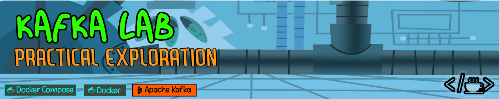

# 

Este repositorio corresponde al trabajo práctico del curso de Apache Kafka y tiene como propósito centralizar el material académico desarrollados durante el curso.

## Lista de Laboratorios

| # | Laboratorio   | Descripción                            | Enlace                                                |
|---|---------------|----------------------------------------|-------------------------------------------------------|
| 1 | Laboratorio 1 | Anatomía de un clúster de tres brokers | [Ver Informe](laboratory/lab-01/execution/informe.md) |
| 2 | Laboratorio 2 | Clúster en modo KRaft y trazado del flujo de un evento | [Ver Informe](laboratory/lab-02/execution/informe.md) |
