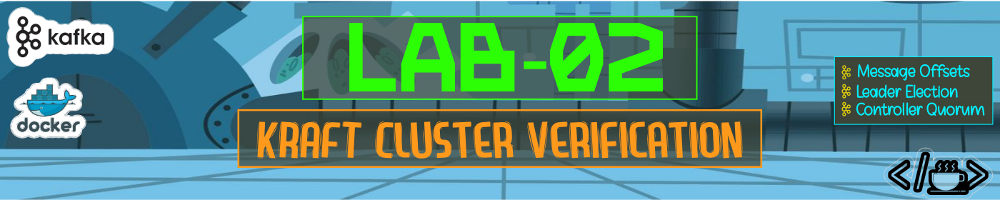
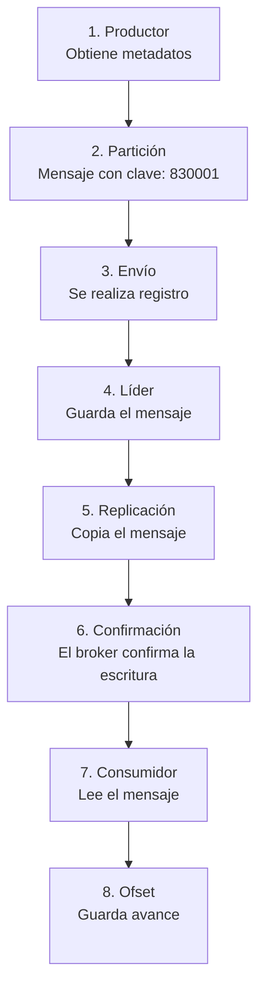

# 

Este directorio contiene las evidencias correspondientes a la ejecución del **Laboratorio 02**, desarrollado como parte del curso de Apache Kafka.


## Evidencias

### 1. Salida del paso 2 con LeaderId y LeaderEpoch. 

Describir el quórum de controladores 

**Resultado Obtenido**: 

```bash
estudiante@ip-192-168-166-62:/home/est2/kafka-dian/entorno$ kq describe --status
ClusterId:              pira-kafka-lab-2026
LeaderId:               1
LeaderEpoch:            1
HighWatermark:          1522
MaxFollowerLag:         0
MaxFollowerLagTimeMs:   0
CurrentVoters:          [{"id": 1, "directoryId": null, "endpoints": ["CONTROLLER://broker1:9093"]}, {"id": 2, "directoryId": null, "endpoints": ["CONTROLLER://broker2:9093"]}, {"id": 3, "directoryId": null, "endpoints": ["CONTROLLER://broker3:9093"]}]
CurrentObservers:       []
```
### 2. Registros del paso 4 (TOPIC_RECORD y un PARTITION_RECORD).

Crear un topic y encontrar su registro 

**Resultado Obtenido**: 

```bash
estudiante@ip-192-168-166-62:/home/est2/kafka-dian/entorno$ QUIPO=equipo10
TOPIC=$EQUIPO.lab02.declaracion.presentada
kt --create --topic "$TOPIC" --partitions 3 --replication-factor 3
docker exec broker1 /opt/kafka/bin/kafka-dump-log.sh --cluster-metadata-decoder \
  --files /var/lib/kafka/data/__cluster_metadata-0/00000000000000000000.log | grep -A3 "$TOPIC" | head -20
WARNING: Due to limitations in metric names, topics with a period ('.') or underscore ('_') could collide. To avoid issues it is best to use either, but not both.
Created topic equipo10.lab02.declaracion.presentada.
| offset: 2080 CreateTime: 1791909751069 keySize: -1 valueSize: 58 sequence: -1 headerKeys: [] payload: {"type":"TOPIC_RECORD","version":0,"data":{"name":"equipo10.lab02.declaracion.presentada","topicId":"KZJoi0WURqqOGkwsEIQ3Cg"}}
| offset: 2081 CreateTime: 1791909751069 keySize: -1 valueSize: 113 sequence: -1 headerKeys: [] payload: {"type":"PARTITION_RECORD","version":1,"data":{"partitionId":0,"topicId":"KZJoi0WURqqOGkwsEIQ3Cg","replicas":[2,3,1],"isr":[2,3,1],"removingReplicas":[],"addingReplicas":[],"leader":2,"leaderEpoch":0,"partitionEpoch":0,"directories":["dKYIU-PJIyhiESoFWTc5Jw","2mIUqn7_-95nlJHPyXg62w","BRI32n4AqQrGSsVr2PPOEQ"]}}
| offset: 2082 CreateTime: 1791909751069 keySize: -1 valueSize: 113 sequence: -1 headerKeys: [] payload: {"type":"PARTITION_RECORD","version":1,"data":{"partitionId":1,"topicId":"KZJoi0WURqqOGkwsEIQ3Cg","replicas":[3,1,2],"isr":[3,1,2],"removingReplicas":[],"addingReplicas":[],"leader":3,"leaderEpoch":0,"partitionEpoch":0,"directories":["2mIUqn7_-95nlJHPyXg62w","BRI32n4AqQrGSsVr2PPOEQ","dKYIU-PJIyhiESoFWTc5Jw"]}}
| offset: 2083 CreateTime: 1791909751069 keySize: -1 valueSize: 113 sequence: -1 headerKeys: [] payload: {"type":"PARTITION_RECORD","version":1,"data":{"partitionId":2,"topicId":"KZJoi0WURqqOGkwsEIQ3Cg","replicas":[1,2,3],"isr":[1,2,3],"removingReplicas":[],"addingReplicas":[],"leader":1,"leaderEpoch":0,"partitionEpoch":0,"directories":["BRI32n4AqQrGSsVr2PPOEQ","dKYIU-PJIyhiESoFWTc5Jw","2mIUqn7_-95nlJHPyXg62w"]}}
```

### 3. Salidas del paso 5 antes y después de la caída, con el tiempo de elección medido, y la respuesta a la pregunta de los dos nodos.

Caída y elección del controlador

**Resultado Obtenido**: 

```bash
estudiante@ip-192-168-166-62:/home/est2/kafka-dian/entorno$ CONTROLADOR=1      
BROKER_VIVO=2      
date +%T
docker stop broker$CONTROLADOR
docker exec broker$BROKER_VIVO /opt/kafka/bin/kafka-metadata-quorum.sh \
  --bootstrap-server broker$BROKER_VIVO:19092 describe --status
date +%T
11:46:39
broker1
ClusterId:              pira-kafka-lab-2026
LeaderId:               2
LeaderEpoch:            2
HighWatermark:          2679
MaxFollowerLag:         2680
MaxFollowerLagTimeMs:   -1
CurrentVoters:          [{"id": 1, "directoryId": null, "endpoints": ["CONTROLLER://broker1:9093"]}, {"id": 2, "directoryId": null, "endpoints": ["CONTROLLER://broker2:9093"]}, {"id": 3, "directoryId": null, "endpoints": ["CONTROLLER://broker3:9093"]}]
CurrentObservers:       []
11:46:49
```
#### 3.1. Registre: el nuevo LeaderId, el nuevo LeaderEpoch (debe haber aumentado) y el tiempo aproximado transcurrido. Típicamente 1–3 segundos.

```bash
estudiante@ip-192-168-166-62:/home/est2/kafka-dian/entorno$ alias kq='docker exec broker2 /opt/kafka/bin/kafka-metadata-quorum.sh --bootstrap-server broker2:19092'
```

```bash
estudiante@ip-192-168-166-62:/home/est2/kafka-dian/entorno$ kq describe --status
ClusterId:              pira-kafka-lab-2026
LeaderId:               2
LeaderEpoch:            2
HighWatermark:          3215
MaxFollowerLag:         3216
MaxFollowerLagTimeMs:   -1
CurrentVoters:          [{"id": 1, "directoryId": null, "endpoints": ["CONTROLLER://broker1:9093"]}, {"id": 2, "directoryId": null, "endpoints": ["CONTROLLER://broker2:9093"]}, {"id": 3, "directoryId": null, "endpoints": ["CONTROLLER://broker3:9093"]}]
CurrentObservers:       []
```
#### 3.2. ¿qué habría pasado si hubiera detenido dos de los tres nodos?

Si se detuvieran dos de los tres nodos, el clúster KRaft perdería la mayoría del quórum.

### 4. Salida del paso 6 con particiones y offsets, y la del grupo $equipo10-lab02-lector.

Producir y consumir registrando offsets

**Resultado Obtenido**: 

```bash
estudiante@ip-192-168-166-62:/home/est2/kafka-dian/entorno$ docker exec broker1 /opt/kafka/bin/kafka-console-consumer.sh --bootstrap-server broker1:19092 \
  --topic "$TOPIC" --from-beginning --timeout-ms 8000 \
  --property print.key=true --property print.partition=true --property print.offset=true 2>/dev/null
Partition:1     Offset:0        900123  {"nit":"900123","formulario":"110","periodo":"2026-08"}
Partition:2     Offset:0        830001  {"nit":"830001","formulario":"110","periodo":"2026-08"}
Partition:2     Offset:1        830001  {"nit":"830001","formulario":"300","periodo":"2026-08"}
```
El diagrama del paso 7.


### 5. Un párrafo: ¿por qué KRaft simplifica la operación frente a ZooKeeper en la entidad?

Al tener que manejar un solo sistema, se eliminan procedimientos de administración que pueden llegar a ser una parte complicada. Adicionalmente, KRaft cuenta con importantes mejoras, como mejoras en el inicio de arranque y en los procesos de recuperación, en el manejo de escalabilidad, y disminuye el riesgo de inconsistencias.
