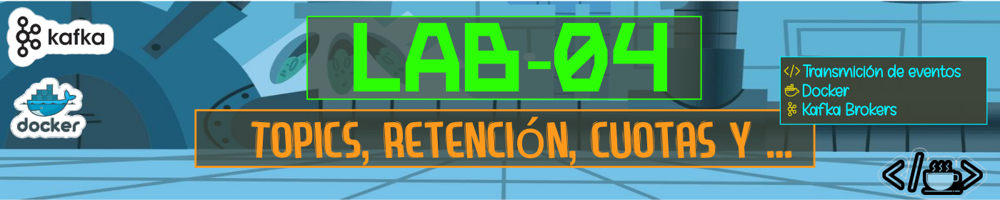

# 

Este directorio contiene las evidencias correspondientes a la ejecución del **Laboratorio 04**, desarrollado como parte del curso de Apache Kafka.

## Evidencias

### 1. Topic compactado con configuración propia

Crear un topic 

```bash
estudiante@ip-192-168-166-62:/home/est2/kafka-dian/entorno$ kt --create --topic "$TOPIC" --partitions 6 --replication-factor 3 \
   --config cleanup.policy=compact --config min.insync.replicas=2 --config segment.bytes=1048576
WARNING: Due to limitations in metric names, topics with a period ('.') or underscore ('_') could collide. To avoid issues it is best to use either, but not both.
Created topic equipo10.lab04.auditoria.acceso.
estudiante@ip-192-168-166-62:/home/est2/kafka-dian/entorno$ kt --describe --topic "$TOPIC" | head -1
Topic: equipo10.lab04.auditoria.acceso  TopicId: lIBfos9tQgKSll1L_689_g PartitionCount: 6       ReplicationFactor: 3    Configs: min.insync.replicas=2,cleanup.policy=compact,segment.bytes=1048576,unclean.leader.election.enable=false

```
TOPIC=$EQUIPO.lab04.auditoria.acceso
TOPIC=$EQUIPO.facturacion.emitida

### 2. Alterar dinámicamente la retención 

```bash
estudiante@ip-192-168-166-62:/home/est2/kafka-dian/entorno$ kc --alter --entity-type topics --entity-name "$TOPIC" --add-config delete.retention.ms=60000,min.compaction.lag.ms=10000
Completed updating config for topic equipo10.lab04.auditoria.acceso.
estudiante@ip-192-168-166-62:/home/est2/kafka-dian/entorno$ kc --describe --entity-type topics --entity-name "$TOPIC"
Dynamic configs for topic equipo10.lab04.auditoria.acceso are:
  cleanup.policy=compact sensitive=false synonyms={DYNAMIC_TOPIC_CONFIG:cleanup.policy=compact, DEFAULT_CONFIG:log.cleanup.policy=delete}
  delete.retention.ms=60000 sensitive=false synonyms={DYNAMIC_TOPIC_CONFIG:delete.retention.ms=60000, DEFAULT_CONFIG:log.cleaner.delete.retention.ms=86400000}
  min.compaction.lag.ms=10000 sensitive=false synonyms={DYNAMIC_TOPIC_CONFIG:min.compaction.lag.ms=10000, DEFAULT_CONFIG:log.cleaner.min.compaction.lag.ms=0}
  min.insync.replicas=2 sensitive=false synonyms={DYNAMIC_TOPIC_CONFIG:min.insync.replicas=2, STATIC_BROKER_CONFIG:min.insync.replicas=2, DEFAULT_CONFIG:min.insync.replicas=1}
  segment.bytes=1048576 sensitive=false synonyms={DYNAMIC_TOPIC_CONFIG:segment.bytes=1048576, DEFAULT_CONFIG:log.segment.bytes=1073741824}
```

Observe: los valores aparecen como DYNAMIC_TOPIC_CONFIG; no hubo reinicio. Elimine uno y verifique:

```bash
estudiante@ip-192-168-166-62:/home/est2/kafka-dian/entorno$ kc --alter --entity-type topics --entity-name "$TOPIC" --delete-config min.compaction.lag.ms
Completed updating config for topic equipo10.lab04.auditoria.acceso.
estudiante@ip-192-168-166-62:/home/est2/kafka-dian/entorno$ kc --describe --entity-type topics --entity-name "$TOPIC" 
Dynamic configs for topic equipo10.lab04.auditoria.acceso are:
  cleanup.policy=compact sensitive=false synonyms={DYNAMIC_TOPIC_CONFIG:cleanup.policy=compact, DEFAULT_CONFIG:log.cleanup.policy=delete}
  delete.retention.ms=60000 sensitive=false synonyms={DYNAMIC_TOPIC_CONFIG:delete.retention.ms=60000, DEFAULT_CONFIG:log.cleaner.delete.retention.ms=86400000}
  min.insync.replicas=2 sensitive=false synonyms={DYNAMIC_TOPIC_CONFIG:min.insync.replicas=2, STATIC_BROKER_CONFIG:min.insync.replicas=2, DEFAULT_CONFIG:min.insync.replicas=1}
  segment.bytes=1048576 sensitive=false synonyms={DYNAMIC_TOPIC_CONFIG:segment.bytes=1048576, DEFAULT_CONFIG:log.segment.bytes=1073741824}
```
### 3. Aplicar una cuota de producción 

Cuota de 1 MB/s para el client.id del generador:

```bash
estudiante@ip-192-168-166-62:/home/est2/kafka-dian/entorno$ kc --alter --entity-type clients --entity-name gen-facturacion --add-config producer_byte_rate=1048576
Completed updating config for client gen-facturacion.
estudiante@ip-192-168-166-62:/home/est2/kafka-dian/entorno$ kc --describe --entity-type clients --entity-name gen-facturacion
Quota configs for client-id 'gen-facturacion' are producer_byte_rate=1048576.0
```
### 4. Observar el efecto de la cuota 

Produzca a alta tasa con y sin cuota y compare el rendimiento reportado:

```bash
estudiante@ip-192-168-166-62:/home/est2/kafka-dian/entorno$ python3 codigo/gen_eventos.py --topic equipo10.facturacion.emitida --n 20000
enviados: 20000

estudiante@ip-192-168-166-62:/home/est2/kafka-dian/entorno$ python3 codigo/gen_eventos.py --topic equipo10.facturacion.emitida --n 20000 --client-id sin-cuota~  
enviados: 20000
```
Mida con time (o compare la duración impresa). Con eventos de ~350 bytes, 1 MB/s ≈ 3.000 ev/s: el primer comando debe tardar notablemente más. En Kafka UI → Brokers → Metrics puede verse el estrangulamiento. Retire la cuota al terminar:

```bash
estudiante@ip-192-168-166-62:/home/est2/kafka-dian/entorno$ kc --alter --entity-type clients --entity-name gen-facturacion --delete-config producer_byte_rate
Completed updating config for client gen-facturacion.

```
### 5. Distribución de espacio

```bash
estudiante@ip-192-168-166-62:/home/est2/kafka-dian/entorno$ docker exec broker1 /opt/kafka/bin/kafka-log-dirs.sh --bootstrap-server broker1:19092 --describe --broker-list 1,2,3 --topic-list pira.facturacion.emitida | tail -1 | python3 -m json.tool | grep -E '"partition"|"size"' | head -12
                            "partition": "pira.facturacion.emitida-3",
                            "size": 0,
                            "partition": "pira.facturacion.emitida-2",
                            "size": 0,
                            "partition": "pira.facturacion.emitida-5",
                            "size": 0,
                            "partition": "pira.facturacion.emitida-4",
                            "size": 0,
                            "partition": "pira.facturacion.emitida-1",
                            "size": 0,
                            "partition": "pira.facturacion.emitida-0",
                            "size": 0,
```
### 6. Autocreación deshabilitada
```bash
estudiante@ip-192-168-166-62:/home/est2/kafka-dian/entorno$ echo "x" | docker exec -i broker1 /opt/kafka/bin/kafka-console-producer.sh --bootstrap-server broker1:19092 --topic topic.que.no.existe
[2026-11-05 05:34:00,493] WARN [Producer clientId=console-producer] The metadata response from the cluster reported a recoverable issue with correlation id 1 : {topic.que.no.existe=UNKNOWN_TOPIC_OR_PARTITION} (org.apache.kafka.clients.NetworkClient)
[2026-11-05 05:34:00,716] WARN [Producer clientId=console-producer] The metadata response from the cluster reported a recoverable issue with correlation id 7 : {topic.que.no.existe=UNKNOWN_TOPIC_OR_PARTITION} (org.apache.kafka.clients.NetworkClient)
[2026-11-05 05:34:00,914] WARN [Producer clientId=console-producer] The metadata response from the cluster reported a recoverable issue with correlation id 9 : {topic.que.no.existe=UNKNOWN_TOPIC_OR_PARTITION} (org.apache.kafka.clients.NetworkClient)
[2026-11-05 05:34:01,375] WARN [Producer clientId=console-producer] The metadata response from the cluster reported a recoverable issue with correlation id 10 : {topic.que.no.existe=UNKNOWN_TOPIC_OR_PARTITION} (org.apache.kafka.clients.NetworkClient)
[2026-11-05 05:34:02,307] WARN [Producer clientId=console-producer] The metadata response from the cluster reported a recoverable issue with correlation id 11 : {topic.que.no.existe=UNKNOWN_TOPIC_OR_PARTITION} (org.apache.kafka.clients.NetworkClient)
[2026-11-05 05:34:03,302] WARN [Producer clientId=console-producer] The metadata response from the cluster reported a recoverable issue with correlation id 12 : {topic.que.no.existe=UNKNOWN_TOPIC_OR_PARTITION} (org.apache.kafka.clients.NetworkClient)
[2026-11-05 05:34:04,305] WARN [Producer clientId=console-producer] The metadata response from the cluster reported a recoverable issue with correlation id 13 : {topic.que.no.existe=UNKNOWN_TOPIC_OR_PARTITION} (org.apache.kafka.clients.NetworkClient)
[2026-11-05 05:34:05,308] WARN [Producer clientId=console-producer] The metadata response from the cluster reported a recoverable issue with correlation id 14 : {topic.que.no.existe=UNKNOWN_TOPIC_OR_PARTITION} (org.apache.kafka.clients.NetworkClient)
[2026-11-05 05:34:06,311] WARN [Producer clientId=console-producer] The metadata response from the cluster reported a recoverable issue with correlation id 15 : {topic.que.no.existe=UNKNOWN_TOPIC_OR_PARTITION} (org.apache.kafka.clients.NetworkClient)
[2026-11-05 05:34:07,313] WARN [Producer clientId=console-producer] The metadata response from the cluster reported a recoverable issue with correlation id 16 : {topic.que.no.existe=UNKNOWN_TOPIC_OR_PARTITION} (org.apache.kafka.clients.NetworkClient)
[2026-11-05 05:34:08,316] WARN [Producer clientId=console-producer] The metadata response from the cluster reported a recoverable issue with correlation id 17 : {topic.que.no.existe=UNKNOWN_TOPIC_OR_PARTITION} (org.apache.kafka.clients.NetworkClient)
[2026-11-05 05:34:09,319] WARN [Producer clientId=console-producer] The metadata response from the cluster reported a recoverable issue with correlation id 18 : {topic.que.no.existe=UNKNOWN_TOPIC_OR_PARTITION} (org.apache.kafka.clients.NetworkClient)
[2026-11-05 05:34:10,321] WARN [Producer clientId=console-producer] The metadata response from the cluster reported a recoverable issue with correlation id 19 : {topic.que.no.existe=UNKNOWN_TOPIC_OR_PARTITION} (org.apache.kafka.clients.NetworkClient)
[2026-11-05 05:34:11,323] WARN [Producer clientId=console-producer] The metadata response from the cluster reported a recoverable issue with correlation id 20 : {topic.que.no.existe=UNKNOWN_TOPIC_OR_PARTITION} (org.apache.kafka.clients.NetworkClient)
[2026-11-05 05:34:12,326] WARN [Producer clientId=console-producer] The metadata response from the cluster reported a recoverable issue with correlation id 21 : {topic.que.no.existe=UNKNOWN_TOPIC_OR_PARTITION} (org.apache.kafka.clients.NetworkClient)
[2026-11-05 05:34:13,329] WARN [Producer clientId=console-producer] The metadata response from the cluster reported a recoverable issue with correlation id 22 : {topic.que.no.existe=UNKNOWN_TOPIC_OR_PARTITION} (org.apache.kafka.clients.NetworkClient)
[2026-11-05 05:34:14,332] WARN [Producer clientId=console-producer] The metadata response from the cluster reported a recoverable issue with correlation id 23 : {topic.que.no.existe=UNKNOWN_TOPIC_OR_PARTITION} (org.apache.kafka.clients.NetworkClient)
[2026-11-05 05:34:15,334] WARN [Producer clientId=console-producer] The metadata response from the cluster reported a recoverable issue with correlation id 24 : {topic.que.no.existe=UNKNOWN_TOPIC_OR_PARTITION} (org.apache.kafka.clients.NetworkClient)
[2026-11-05 05:34:16,336] WARN [Producer clientId=console-producer] The metadata response from the cluster reported a recoverable issue with correlation id 25 : {topic.que.no.existe=UNKNOWN_TOPIC_OR_PARTITION} (org.apache.kafka.clients.NetworkClient)
[2026-11-05 05:34:17,337] WARN [Producer clientId=console-producer] The metadata response from the cluster reported a recoverable issue with correlation id 26 : {topic.que.no.existe=UNKNOWN_TOPIC_OR_PARTITION} (org.apache.kafka.clients.NetworkClient)
[2026-11-05 05:34:18,340] WARN [Producer clientId=console-producer] The metadata response from the cluster reported a recoverable issue with correlation id 27 : {topic.que.no.existe=UNKNOWN_TOPIC_OR_PARTITION} (org.apache.kafka.clients.NetworkClient)
[2026-11-05 05:34:19,316] WARN [Producer clientId=console-producer] The metadata response from the cluster reported a recoverable issue with correlation id 28 : {topic.que.no.existe=UNKNOWN_TOPIC_OR_PARTITION} (org.apache.kafka.clients.NetworkClient)
[2026-11-05 05:34:20,284] WARN [Producer clientId=console-producer] The metadata response from the cluster reported a recoverable issue with correlation id 29 : {topic.que.no.existe=UNKNOWN_TOPIC_OR_PARTITION} (org.apache.kafka.clients.NetworkClient)
[2026-11-05 05:34:21,286] WARN [Producer clientId=console-producer] The metadata response from the cluster reported a recoverable issue with correlation id 30 : {topic.que.no.existe=UNKNOWN_TOPIC_OR_PARTITION} (org.apache.kafka.clients.NetworkClient)
[2026-11-05 05:34:22,289] WARN [Producer clientId=console-producer] The metadata response from the cluster reported a recoverable issue with correlation id 31 : {topic.que.no.existe=UNKNOWN_TOPIC_OR_PARTITION} (org.apache.kafka.clients.NetworkClient)
[2026-11-05 05:34:23,292] WARN [Producer clientId=console-producer] The metadata response from the cluster reported a recoverable issue with correlation id 32 : {topic.que.no.existe=UNKNOWN_TOPIC_OR_PARTITION} (org.apache.kafka.clients.NetworkClient)
[2026-11-05 05:34:24,294] WARN [Producer clientId=console-producer] The metadata response from the cluster reported a recoverable issue with correlation id 33 : {topic.que.no.existe=UNKNOWN_TOPIC_OR_PARTITION} (org.apache.kafka.clients.NetworkClient)
[2026-11-05 05:34:25,295] WARN [Producer clientId=console-producer] The metadata response from the cluster reported a recoverable issue with correlation id 34 : {topic.que.no.existe=UNKNOWN_TOPIC_OR_PARTITION} (org.apache.kafka.clients.NetworkClient)
[2026-11-05 05:34:26,267] WARN [Producer clientId=console-producer] The metadata response from the cluster reported a recoverable issue with correlation id 35 : {topic.que.no.existe=UNKNOWN_TOPIC_OR_PARTITION} (org.apache.kafka.clients.NetworkClient)
[2026-11-05 05:34:27,269] WARN [Producer clientId=console-producer] The metadata response from the cluster reported a recoverable issue with correlation id 36 : {topic.que.no.existe=UNKNOWN_TOPIC_OR_PARTITION} (org.apache.kafka.clients.NetworkClient)
[2026-11-05 05:34:28,271] WARN [Producer clientId=console-producer] The metadata response from the cluster reported a recoverable issue with correlation id 37 : {topic.que.no.existe=UNKNOWN_TOPIC_OR_PARTITION} (org.apache.kafka.clients.NetworkClient)
[2026-11-05 05:34:29,274] WARN [Producer clientId=console-producer] The metadata response from the cluster reported a recoverable issue with correlation id 38 : {topic.que.no.existe=UNKNOWN_TOPIC_OR_PARTITION} (org.apache.kafka.clients.NetworkClient)
[2026-11-05 05:34:30,277] WARN [Producer clientId=console-producer] The metadata response from the cluster reported a recoverable issue with correlation id 39 : {topic.que.no.existe=UNKNOWN_TOPIC_OR_PARTITION} (org.apache.kafka.clients.NetworkClient)
[2026-11-05 05:34:31,279] WARN [Producer clientId=console-producer] The metadata response from the cluster reported a recoverable issue with correlation id 40 : {topic.que.no.existe=UNKNOWN_TOPIC_OR_PARTITION} (org.apache.kafka.clients.NetworkClient)
[2026-11-05 05:34:32,196] WARN [Producer clientId=console-producer] The metadata response from the cluster reported a recoverable issue with correlation id 41 : {topic.que.no.existe=UNKNOWN_TOPIC_OR_PARTITION} (org.apache.kafka.clients.NetworkClient)
[2026-11-05 05:34:33,198] WARN [Producer clientId=console-producer] The metadata response from the cluster reported a recoverable issue with correlation id 42 : {topic.que.no.existe=UNKNOWN_TOPIC_OR_PARTITION} (org.apache.kafka.clients.NetworkClient)
[2026-11-05 05:34:34,201] WARN [Producer clientId=console-producer] The metadata response from the cluster reported a recoverable issue with correlation id 43 : {topic.que.no.existe=UNKNOWN_TOPIC_OR_PARTITION} (org.apache.kafka.clients.NetworkClient)
[2026-11-05 05:34:35,204] WARN [Producer clientId=console-producer] The metadata response from the cluster reported a recoverable issue with correlation id 44 : {topic.que.no.existe=UNKNOWN_TOPIC_OR_PARTITION} (org.apache.kafka.clients.NetworkClient)
[2026-11-05 05:34:36,207] WARN [Producer clientId=console-producer] The metadata response from the cluster reported a recoverable issue with correlation id 45 : {topic.que.no.existe=UNKNOWN_TOPIC_OR_PARTITION} (org.apache.kafka.clients.NetworkClient)
[2026-11-05 05:34:37,209] WARN [Producer clientId=console-producer] The metadata response from the cluster reported a recoverable issue with correlation id 46 : {topic.que.no.existe=UNKNOWN_TOPIC_OR_PARTITION} (org.apache.kafka.clients.NetworkClient)
[2026-11-05 05:34:38,212] WARN [Producer clientId=console-producer] The metadata response from the cluster reported a recoverable issue with correlation id 47 : {topic.que.no.existe=UNKNOWN_TOPIC_OR_PARTITION} (org.apache.kafka.clients.NetworkClient)
[2026-11-05 05:34:39,214] WARN [Producer clientId=console-producer] The metadata response from the cluster reported a recoverable issue with correlation id 48 : {topic.que.no.existe=UNKNOWN_TOPIC_OR_PARTITION} (org.apache.kafka.clients.NetworkClient)
[2026-11-05 05:34:40,219] WARN [Producer clientId=console-producer] The metadata response from the cluster reported a recoverable issue with correlation id 49 : {topic.que.no.existe=UNKNOWN_TOPIC_OR_PARTITION} (org.apache.kafka.clients.NetworkClient)
[2026-11-05 05:34:41,220] WARN [Producer clientId=console-producer] The metadata response from the cluster reported a recoverable issue with correlation id 50 : {topic.que.no.existe=UNKNOWN_TOPIC_OR_PARTITION} (org.apache.kafka.clients.NetworkClient)
[2026-11-05 05:34:42,222] WARN [Producer clientId=console-producer] The metadata response from the cluster reported a recoverable issue with correlation id 51 : {topic.que.no.existe=UNKNOWN_TOPIC_OR_PARTITION} (org.apache.kafka.clients.NetworkClient)
[2026-11-05 05:34:43,225] WARN [Producer clientId=console-producer] The metadata response from the cluster reported a recoverable issue with correlation id 52 : {topic.que.no.existe=UNKNOWN_TOPIC_OR_PARTITION} (org.apache.kafka.clients.NetworkClient)
[2026-11-05 05:34:44,228] WARN [Producer clientId=console-producer] The metadata response from the cluster reported a recoverable issue with correlation id 53 : {topic.que.no.existe=UNKNOWN_TOPIC_OR_PARTITION} (org.apache.kafka.clients.NetworkClient)
[2026-11-05 05:34:45,231] WARN [Producer clientId=console-producer] The metadata response from the cluster reported a recoverable issue with correlation id 54 : {topic.que.no.existe=UNKNOWN_TOPIC_OR_PARTITION} (org.apache.kafka.clients.NetworkClient)
[2026-11-05 05:34:46,234] WARN [Producer clientId=console-producer] The metadata response from the cluster reported a recoverable issue with correlation id 55 : {topic.que.no.existe=UNKNOWN_TOPIC_OR_PARTITION} (org.apache.kafka.clients.NetworkClient)
[2026-11-05 05:34:47,236] WARN [Producer clientId=console-producer] The metadata response from the cluster reported a recoverable issue with correlation id 56 : {topic.que.no.existe=UNKNOWN_TOPIC_OR_PARTITION} (org.apache.kafka.clients.NetworkClient)
[2026-11-05 05:34:48,238] WARN [Producer clientId=console-producer] The metadata response from the cluster reported a recoverable issue with correlation id 57 : {topic.que.no.existe=UNKNOWN_TOPIC_OR_PARTITION} (org.apache.kafka.clients.NetworkClient)
[2026-11-05 05:34:49,241] WARN [Producer clientId=console-producer] The metadata response from the cluster reported a recoverable issue with correlation id 58 : {topic.que.no.existe=UNKNOWN_TOPIC_OR_PARTITION} (org.apache.kafka.clients.NetworkClient)
[2026-11-05 05:34:50,243] WARN [Producer clientId=console-producer] The metadata response from the cluster reported a recoverable issue with correlation id 59 : {topic.que.no.existe=UNKNOWN_TOPIC_OR_PARTITION} (org.apache.kafka.clients.NetworkClient)
[2026-11-05 05:34:51,245] WARN [Producer clientId=console-producer] The metadata response from the cluster reported a recoverable issue with correlation id 60 : {topic.que.no.existe=UNKNOWN_TOPIC_OR_PARTITION} (org.apache.kafka.clients.NetworkClient)
[2026-11-05 05:34:52,248] WARN [Producer clientId=console-producer] The metadata response from the cluster reported a recoverable issue with correlation id 61 : {topic.que.no.existe=UNKNOWN_TOPIC_OR_PARTITION} (org.apache.kafka.clients.NetworkClient)
[2026-11-05 05:34:53,250] WARN [Producer clientId=console-producer] The metadata response from the cluster reported a recoverable issue with correlation id 62 : {topic.que.no.existe=UNKNOWN_TOPIC_OR_PARTITION} (org.apache.kafka.clients.NetworkClient)
[2026-11-05 05:34:54,252] WARN [Producer clientId=console-producer] The metadata response from the cluster reported a recoverable issue with correlation id 63 : {topic.que.no.existe=UNKNOWN_TOPIC_OR_PARTITION} (org.apache.kafka.clients.NetworkClient)
[2026-11-05 05:34:55,256] WARN [Producer clientId=console-producer] The metadata response from the cluster reported a recoverable issue with correlation id 64 : {topic.que.no.existe=UNKNOWN_TOPIC_OR_PARTITION} (org.apache.kafka.clients.NetworkClient)
[2026-11-05 05:34:56,258] WARN [Producer clientId=console-producer] The metadata response from the cluster reported a recoverable issue with correlation id 65 : {topic.que.no.existe=UNKNOWN_TOPIC_OR_PARTITION} (org.apache.kafka.clients.NetworkClient)
[2026-11-05 05:34:57,260] WARN [Producer clientId=console-producer] The metadata response from the cluster reported a recoverable issue with correlation id 66 : {topic.que.no.existe=UNKNOWN_TOPIC_OR_PARTITION} (org.apache.kafka.clients.NetworkClient)
[2026-11-05 05:34:58,262] WARN [Producer clientId=console-producer] The metadata response from the cluster reported a recoverable issue with correlation id 67 : {topic.que.no.existe=UNKNOWN_TOPIC_OR_PARTITION} (org.apache.kafka.clients.NetworkClient)
[2026-11-05 05:34:59,264] WARN [Producer clientId=console-producer] The metadata response from the cluster reported a recoverable issue with correlation id 68 : {topic.que.no.existe=UNKNOWN_TOPIC_OR_PARTITION} (org.apache.kafka.clients.NetworkClient)
[2026-11-05 05:34:59,913] ERROR Error when sending message to topic topic.que.no.existe with key: null, value: 1 bytes with error: (org.apache.kafka.clients.producer.internals.ErrorLoggingCallback)
org.apache.kafka.common.errors.TimeoutException: Topic topic.que.no.existe not present in metadata after 60000 ms.
Caused by: org.apache.kafka.common.errors.UnknownTopicOrPartitionException: This server does not host this topic-partition.
estudiante@ip-192-168-166-62:/home/est2/kafka-dian/entorno$ kt --list | grep "no.existe" || echo "no se creó: correcto"
no se creó: correcto
```
### Preguntas

#### A. ¿qué parámetro habría que cambiar, en qué nivel y con qué herramienta, para que la retención de equipo10.facturacion.emitida pase a 45 días sin reiniciar? 

Seria en el paso 3, donde retention.ms = 45 × 24 × 60 × 60 × 1000 = 3,888,000,000 ms
con el comando

```bash
kc --alter --entity-type topics --entity-name equipo10.facturacion.emitida \
   --add-config retention.ms=3888000000
```   
#### B. ¿Por qué la cuota no produce errores en el cliente sino solo lentitud?

Kafka no rechaza las peticiones cuando un cliente supera la cuota establecida, sino que las ralentiza para controlar el ritmo de envío.

#### C. ¿Por qué en AWS compartido usamos topics con prefijo por equipo?

Porque Kafka no tiene un concepto nativo de “namespace” o “tenant”; la forma estándar de crear “espacios de usuario” en un cluster compartido es mediante una estructura jerárquica de nombres de topic.

El prefijo (equipo10., equipo01., etc.) cumple varias funciones críticas en un entorno multiusuario como el de AWS:

Evitar colisiones de nombres: Sin prefijo, dos equipos podrían crear un topic llamado facturacion.emitida y pisarse mutuamente. El prefijo garantiza unicidad global en el cluster.

Permitir ACLs basadas en prefijo: Kafka permite aplicar ACLs con --resource-pattern-type Prefixed, de modo que una sola regla puede otorgar (o restringir) acceso a todos los topics que empiecen con el prefijo de un equipo. Esto simplifica enormemente la seguridad en un cluster compartido.

Facilitar el gobierno y la auditoría: Es fácil identificar visualmente a qué equipo pertenece cada topic, aplicar cuotas o políticas de retención por prefijo, y monitorear el consumo de recursos por equipo. Además, se puede usar una CreateTopicPolicy en el broker para rechazar la creación de topics que no sigan el patrón de prefijo, convirtiendo la convención en una regla aplicada automáticamente.
