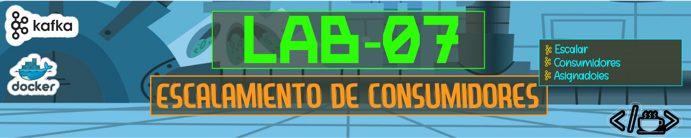

# 

Este directorio contiene las evidencias correspondientes a la ejecución del **Laboratorio 07**, desarrollado como parte del curso de Apache Kafka.

## Evidencias


### 2. consumidor; medir el lag cada 30 s ★


#### Terminal B: 

```bash
(.venv) estudiante@ip-192-168-166-62:/home/est2/equipo10/kafka-dian/entorno$ SLEEP_MS=5 python3 codigo/consumidor_facturacion.py --topic "$TOPIC" --group "$GROUP" --upsert
evento cda0411a-b071-4dea-b3bc-5cab26cbf61d, 987724672, 93fdd7762ac24096918fa2200bd54ec9
evento 97e6833e-c858-4e92-a421-d5bad42f6667, 985793546, 70971b8699bc478bbb7d7a66504c18cd
evento cb939c3a-03ef-48b9-83db-2e3302314b5d, 959982280, 2a83b236a37e4cb594b4c48c875b751b
evento 08083f13-304b-4e38-a910-a7feac88090c, 969963356, badce68dbecb4bf58fb44fb93a5ed6f9
evento c38c7a92-5a97-4e10-90a5-870553c8c538, 967502480, 152f29f302e8483a873f67fa89048f30
evento 90f0b8fb-46eb-4774-8741-7bfbb9e80a78, 969003250, 689248052017483cb203b7415b147132
evento 2dd1c0a0-8b80-4392-9f72-5039e71ea3f4, 938950432, 982082401b3b4ce3b667376dc33fd507
```

#### Terminal C:

```bash
(.venv) estudiante@ip-192-168-166-62:/home/est2/equipo10/kafka-dian/entorno$ for i in $(seq 1 6); do date +%T; kg --describe --group "$GROUP" | awk 'NR>1 {lag+=$6} END {print "LAG TOTAL:", lag}'; sleep 30; done
16:04:23
LAG TOTAL: 560242
16:04:58
LAG TOTAL: 563581
16:05:31
LAG TOTAL: 566861
```